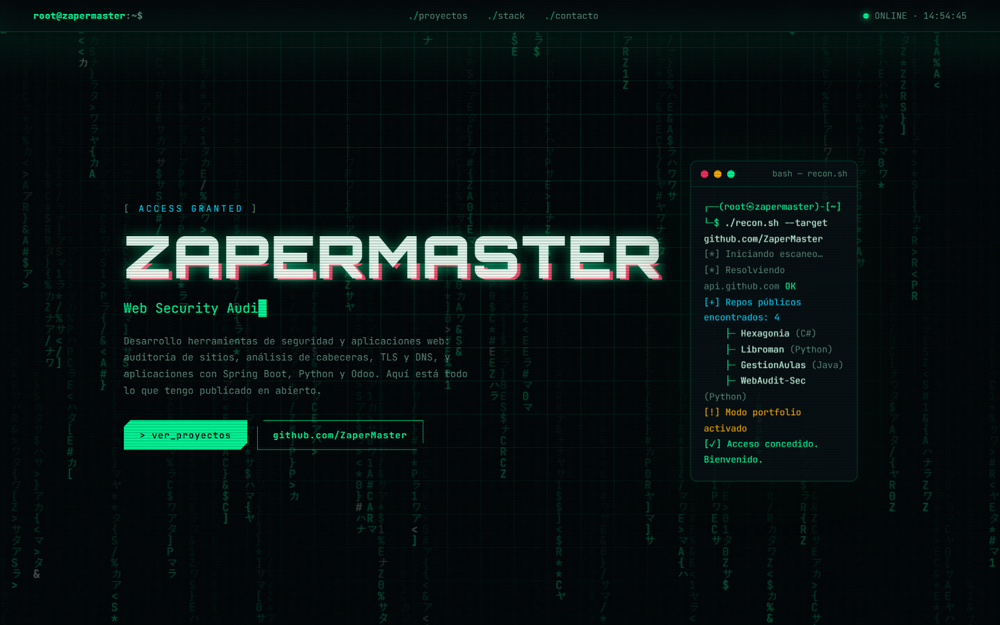
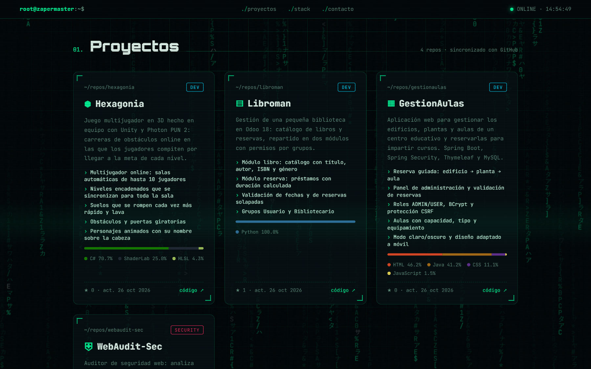
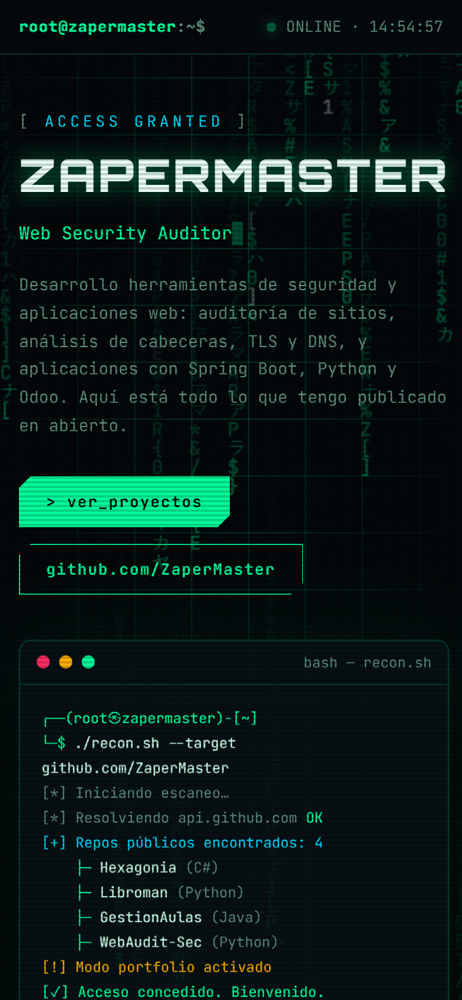

# 🛡️ ZaperMaster · Portfolio

[](https://zapermaster.github.io/web/)


Mi portfolio personal con estética de terminal y ciberseguridad. Muestra mis proyectos públicos
de GitHub **en directo**: si publico un repositorio nuevo, aparece solo en la web.

👉 **https://zapermaster.github.io/web/**

<p align="center">
  
</p>

| Proyectos | Móvil |
|---|---|
|  |  |

## Cómo funciona

- Al cargar la página, consulta la **API pública de GitHub** y pinta una tarjeta por cada repositorio
  público, con sus lenguajes, estrellas y fecha de la última actualización.
- La terminal de la portada "escanea" la cuenta y lista los repositorios encontrados.
- Los proyectos destacados tienen una ficha propia (descripción, funcionalidades, icono y tipo
  `SECURITY` / `DEV`) definida en el objeto `EXTRA` de `index.html`. Los demás usan la descripción
  que tengan en GitHub.
- Si la API no responde (por ejemplo, por el límite de peticiones), se muestran los datos guardados
  en `FALLBACK`, así que la web nunca se queda vacía.
- Se ocultan los repositorios que no son proyectos: esta web y el del README de perfil.

## Detalles

- **Sin frameworks ni dependencias**: un único `index.html` con HTML, CSS y JavaScript.
- Animaciones: lluvia de caracteres en un `canvas`, título con efecto *glitch*, texto que se escribe
  solo, tarjetas con inclinación 3D al pasar el ratón y contadores animados.
- **Accesible**: respeta `prefers-reduced-motion` (desactiva las animaciones) y se adapta al móvil.
- Publicada con **GitHub Pages** desde la rama `main`.

## Añadir o cambiar un proyecto

1. Haz público el repositorio en GitHub: aparecerá automáticamente.
2. Para darle una ficha propia, añádelo a `EXTRA` en `index.html`:

   ```js
   "MiProyecto": {
     type: "sec",                 // "sec" (SECURITY) o "dev" (DEV)
     icon: "⛨",
     description: "Qué hace el proyecto.",
     features: ["Funcionalidad 1", "Funcionalidad 2"]
   }
   ```

## Probarla en local

```bash
python -m http.server 8000
```

Y abre <http://localhost:8000>.

## Autor

Hecho por [ZaperMaster](https://github.com/ZaperMaster).
